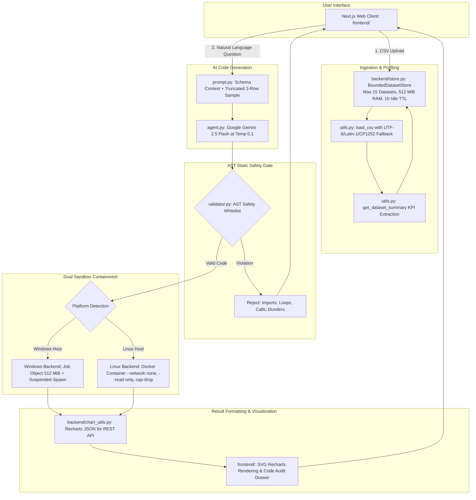

# 📊 AI Data Analyst Agent

> **Turn raw tabular datasets into actionable business insights, statistics, and visualizations using conversational plain English.**

---

## 📌 Overview

Traditional exploratory data analysis requires writing boilerplate Pandas transformations, handling missing data, and manually assembling plotting scripts. **AI Data Analyst Agent** bridges this gap by letting users upload any CSV dataset and query it conversationally. Powered by Google Gemini (`gemini-2.5-flash`), the system profiles the data, generates precise Pandas queries, runs them inside an isolated and AST-validated execution sandbox, and renders interactive metrics, tables, and publication-ready charts on the fly.

The project provides a modern full-stack web application:
1. **Next.js Frontend (`frontend/`):** A modern TypeScript/React interface featuring drag-and-drop CSV upload, automated profiling KPI cards, an interactive dataset inspector modal, natural-language query workspace, responsive Recharts visualization with custom editorial styling, and an expandable Python code audit drawer.
2. **FastAPI REST API (`backend/main.py`):** A strongly typed HTTP backend featuring bounded session storage (`BoundedDatasetStore`), multi-layer execution sandboxing, Recharts-compatible JSON visualization serialization, and full CORS support for modern web clients.

---

## ✨ Features

- **⚡ Automated Dataset Profiling:** Instantly inspect high-level KPIs upon upload—including total rows, columns, null value counts, duplicate rows, data types, and a 10-row interactive data preview.
- **💬 Natural Language Querying:** Ask analytical questions in conversational English (e.g., *"What is the total sales by category?"* or *"Which 5 product categories generated the highest profit margin?"*).
- **🧠 Context-Grounded Code Generation:** Uses the official Google GenAI SDK (`google-genai`) with schema-aware prompt engineering to generate targeted Python/Pandas operations without hallucinating external schemas.
- **🛡️ AST-Based Static Code Validation:** Parses LLM code into Python's Abstract Syntax Tree (`ast.walk`) to enforce a strict whitelist—blocking arbitrary imports, system calls, loops, functions, and dunder methods before execution.
- **🔒 Dual-Containment Runtime Sandbox:**
  - **Windows (Native / Development):** Unified execution model utilizing Windows Job Objects (`win32job`) with memory limits (512 MiB), single-process constraints (`JOB_OBJECT_LIMIT_ACTIVE_PROCESS = 1`), suspended process creation, and explicit handle whitelisting (`STARTUPINFOEXW`).
  - **Linux (Containerized / Production):** Hardened Docker containment executing with `--network none`, `--read-only` rootfs, `--cap-drop ALL`, `--security-opt no-new-privileges:true`, `--pull=never`, non-root user execution, cgroups limits (512 MiB RAM, 1 CPU, 16 PIDs), and isolated IPC mounts (`in/:ro`, `out/:rw`, `tmpfs:/tmp`).
- **💾 Bounded In-Memory Dataset Store:** Thread-safe, memory-bounded, TTL-aware in-process storage (`BoundedDatasetStore`) with atomic LRU eviction, active query reference counting, and explicit deletion lifecycle.
- **🔍 Fuzzy Error Recovery:** Automatically catches `KeyError` exceptions and uses string similarity heuristics (`difflib`) to suggest existing columns when column typos occur.
- **📈 Interactive Data Visualizations:** Deterministic chart detection and Recharts SVG rendering (Bar Charts, Histograms, Scatter Plots, Time-Series Line Charts, and Pie/Donut Charts) with hover tooltips, slice labels, and legends.
- **💻 Transparent Code Inspection:** Displays the generated, validated Python code alongside results with execution status badges for full auditability.

---

## 🏗️ Architecture & Data Flow



---

## 💻 Tech Stack

- **Core Language:** Python 3.10+ (Tested on Python 3.12)
- **API Backend:** [FastAPI](https://fastapi.tiangolo.com/), [Uvicorn](https://www.uvicorn.org/)
- **Frontend Application:** [Next.js](https://nextjs.org/) 14 (React 18, TypeScript, Tailwind CSS)
- **LLM Reasoning:** [Google GenAI SDK](https://github.com/googleapis/python-genai) (`gemini-2.5-flash`)
- **Data Manipulation & Serialization:** [Pandas](https://pandas.pydata.org/), [NumPy](https://numpy.org/), [PyArrow](https://arrow.apache.org/)
- **Visualization:** [Recharts](https://recharts.org/) (Frontend) & Deterministic Chart Selection (`charts.py`, `backend/chart_utils.py`)
- **Code Security & AST Analysis:** Python Native `ast`, `difflib`
- **Containment & OS Isolation:** Windows Job Objects (`win32job`), Linux Docker Engine (`docker-ce`)
- **Configuration & Environment:** `python-dotenv`

---

## ⚙️ Setup & Installation

### 1. Prerequisites
- **Python 3.10+** (Python 3.12 recommended)
- **Node.js 18+** & **npm** (for the Next.js frontend)
- **Git**
- *(Optional for Linux Container Sandbox)*: **Docker Engine** (`docker-ce`)

### 2. Clone the Repository
```bash
git clone https://github.com/Aashi0105/Ai-data-analyst-agent.git
cd Ai-data-analyst-agent
```

### 3. Backend Setup (Python Virtual Environment)
- **On Windows (PowerShell):**
  ```powershell
  python -m venv venv
  .\venv\Scripts\Activate.ps1
  pip install -r requirements.txt
  ```
- **On macOS / Linux:**
  ```bash
  python3 -m venv venv
  source venv/bin/activate
  pip install -r requirements.txt
  ```

### 4. Frontend Setup (Next.js Application)
In a separate terminal (or after backend dependency installation):
```bash
cd frontend
npm install
cd ..
```

### 5. Configure Environment Variables
#### Backend Configuration (`.env`)
Copy the backend environment template:
- **Windows (PowerShell):**
  ```powershell
  Copy-Item .env.example .env
  ```
- **macOS / Linux:**
  ```bash
  cp .env.example .env
  ```

Edit `.env` to supply your Google Gemini API key:
```env
# Required: Google Gemini API Key (Obtain via Google AI Studio)
GEMINI_API_KEY=your_actual_gemini_api_key_here

# Optional: Dataset Storage Configuration (Defaults shown)
DATASET_STORE_MAX_DATASETS=15
DATASET_STORE_MAX_MEMORY_MB=512
DATASET_STORE_TTL_SECONDS=3600.0

# Optional: Allowed CORS Origin for Web Client (Defaults shown)
FRONTEND_ORIGIN=http://localhost:3000
```
> [!NOTE]
> Obtain a free Gemini API key via [Google AI Studio](https://aistudio.google.com/).

#### Frontend Configuration (`frontend/.env.local`)
The Next.js client connects to `http://localhost:8000` by default. To customize this, copy the template:
```bash
cd frontend
cp .env.example .env.local
```
Contents of `frontend/.env.local`:
```env
NEXT_PUBLIC_API_URL=http://localhost:8000
```

---

## 🚀 Running the Application

Start the backend and frontend in separate terminals:

### Terminal 1: Launch FastAPI Backend
```bash
# Ensure virtual environment is activated
uvicorn backend.main:app --port 8000
```
- **Backend API:** `http://127.0.0.1:8000`
- **Interactive Swagger Docs:** `http://127.0.0.1:8000/docs`
- **ReDoc:** `http://127.0.0.1:8000/redoc`

> [!IMPORTANT]
> **ASGI Deployment Constraint:** The FastAPI backend uses an in-process memory-bounded store (`BoundedDatasetStore`). Always run Uvicorn in single-worker mode (`--workers 1`). Multi-worker clustering requires an external distributed cache (e.g., Redis).

### Terminal 2: Launch Next.js Frontend
```bash
cd frontend
npm run dev
```
Open your browser and navigate to `http://localhost:3000`.

---

## 🔌 REST API Specification

The FastAPI backend exposes strongly typed endpoints for dataset session lifecycle management and analytical queries under the `/api` prefix:

### 1. Service Health Check
- **`GET /api/health`**
- **Response `200 OK`**:
  ```json
  {
    "status": "healthy",
    "service": "AI Data Analyst Agent API",
    "version": "1.0.0",
    "datasets_in_memory": 1
  }
  ```

### 2. Upload Dataset
- **`POST /api/datasets/upload`**
- **Content-Type:** `multipart/form-data` (Field: `file`, max size: **25 MiB**)
- **Responses:**
  - `200 OK`: Returns dataset metadata, column schema, and first 10 rows.
    ```json
    {
      "dataset_id": "3fa85f64-5717-4562-b3fc-2c963f66afa6",
      "filename": "sales.csv",
      "num_rows": 1000,
      "num_cols": 5,
      "total_missing": 0,
      "duplicate_rows": 0,
      "columns": ["Date", "Category", "Sales", "Profit", "Region"],
      "dtypes": {"Date": "object", "Category": "object", "Sales": "int64", "Profit": "int64", "Region": "object"},
      "schema": [
        {"column": "Category", "type": "object", "missing_count": 0, "missing_pct": 0.0}
      ],
      "preview": [{"Category": "Tech", "Sales": 150, "Profit": 30}]
    }
    ```
  - `400 Bad Request`: Non-CSV file or malformed CSV contents.
  - `413 Payload Too Large`: Upload exceeds 25 MiB limit.
  - `503 Service Unavailable`: Dataset store capacity exhausted and all active datasets are in use.

### 3. Load Sample Evaluation Dataset
- **`POST /api/datasets/sample`**
- **Response `200 OK`**: Loads the bundled benchmark dataset (`data/ecommerce_sales.csv`) for instant one-click demonstration without disk re-reading.

### 4. Get Dataset Metadata
- **`GET /api/datasets/{dataset_id}`**
- **Responses:**
  - `200 OK`: Dataset summary and preview records.
  - `404 Not Found`: Dataset not found or session expired.

### 5. Natural Language Query Analysis
- **`POST /api/analyze`**
- **Content-Type:** `application/json`
- **Request Body:**
  ```json
  {
    "dataset_id": "3fa85f64-5717-4562-b3fc-2c963f66afa6",
    "question": "What is the total sales by category?"
  }
  ```
- **Responses:**
  - `200 OK`:
    ```json
    {
      "question": "What is the total sales by category?",
      "code": "result = df.groupby('Category')['Sales'].sum()",
      "validation_status": "passed",
      "validation_message": "Code passed AST validation.",
      "execution_status": "passed",
      "error_message": null,
      "result_type": "series",
      "formatted_result": "Showing 3 items.",
      "table_data": {
        "columns": ["Category", "Sales"],
        "rows": [
          {"Category": "Electronics", "Sales": 1225},
          {"Category": "Furniture", "Sales": 450},
          {"Category": "Office", "Sales": 20}
        ]
      },
      "visualization": {
        "chart_type": "bar",
        "data": [
          {"Category": "Electronics", "Sales": 1225},
          {"Category": "Furniture", "Sales": 450},
          {"Category": "Office", "Sales": 20}
        ],
        "x_key": "Category",
        "y_keys": ["Sales"],
        "title": "Sales by Category"
      },
      "execution_time_ms": 2150
    }
    ```
  - `404 Not Found`: Dataset session expired or ID not found.
  - `429 Too Many Requests`: Gemini API rate limit or daily quota exhausted (`RESOURCE_EXHAUSTED`).

### 6. Delete Dataset
- **`DELETE /api/datasets/{dataset_id}`**
- **Responses:**
  - `200 OK`: `{"status": "deleted", "dataset_id": "...", "message": "Dataset successfully removed from memory."}`
  - `404 Not Found`: Dataset not found or expired.
  - `409 Conflict`: Dataset is actively executing an analytical query; cannot delete until active reference is released.

---

## 💾 Dataset Storage Limits, TTL & Eviction

The backend manages dataset state through `BoundedDatasetStore` (`backend/store.py`), preventing memory exhaustion Denial-of-Service (DoS):

| Parameter | Default Value | Environment Variable | Description |
|---|---|---|---|
| **Max Datasets** | `15` | `DATASET_STORE_MAX_DATASETS` | Maximum number of concurrent datasets retained in memory. |
| **Max Aggregate RAM** | `512 MiB` | `DATASET_STORE_MAX_MEMORY_MB` | Cumulative DataFrame memory ceiling calculated via `df.memory_usage(deep=True)`. |
| **Idle TTL** | `3600.0 s` (1 hour) | `DATASET_STORE_TTL_SECONDS` | Expired datasets are lazily purged on subsequent access or capacity checks. |
| **Max Upload Size** | `25 MiB` | Constant (`MAX_UPLOAD_SIZE_MB`) | Strict streaming chunk limit for single file uploads. |

### Lifecycle & Eviction Guarantees:
- **Active Query Immunity:** A dataset currently undergoing Gemini code generation or sandbox execution has `active_queries > 0`. It is immune from LRU eviction and manual deletion (`409 Conflict`).
- **LRU Eviction:** When capacity is needed, inactive unexpired datasets are evicted in Least-Recently-Used order.
- **Atomic All-or-Nothing Insertion:** If an incoming dataset cannot fit even after evicting all eligible inactive datasets, the store rejects the insertion with `503 Service Unavailable` without evicting or altering existing entries.
- **TTL Refresh:** Dataset `last_accessed` timestamp refreshes on query start and release.

---

## 🧪 Running Tests & Validation

The test suite consists of **two distinct validation workflows** (256 total collected items):
- **General Test Suite (Windows & Linux CI):** 253 tests covering unit, AST validation, Windows Job Object containment, error recovery, API lifecycle, Recharts chart serialization, credential redaction, and PII masking. Docker tests are deselected (`-k "not test_docker_real_container"`).
- **Docker Containment Workflow (Native Linux CI Only):** 3 real integration tests exercising `--network none`, `--read-only` rootfs, and container lifecycle boundaries on an Ubuntu runner with Docker daemon.

### 1. General Test Suite (Windows & Linux CI)
Run the full non-Docker test suite:
```bash
pytest tests/ -k "not test_docker_real_container" -v --tb=short
```
*Current verified result:* **253 passed, 3 deselected, 14 warnings** (executed offline without external network or API keys).

### 2. Real Linux Docker Containment Tests (Linux Only)
The 3 real Docker containment tests require a native Linux host with the Docker daemon running and the sandbox image built:
```bash
# 1. Build the sandbox container image
docker build -t ai-data-analyst-sandbox:latest -f Dockerfile.sandbox .

# 2. Run real Docker containment integration tests
pytest tests/test_sandbox.py -k "test_docker_real_container" -v
```
*Current verified result:* **3 passed, 0 skipped** (executed in `.github/workflows/sandbox-linux-validation.yml`).

These tests verify `--network none` blockades, `--read-only` rootfs write rejections, and execution timeouts in GitHub Actions on Ubuntu runners (`.github/workflows/sandbox-linux-validation.yml`). On Windows workstations, these container tests are skipped/deselected, and Windows Job Objects are tested natively.

---

## 🛡️ Security, Privacy & Deployment Considerations

### 1. Code Security (Two-Phase Defense)
1. **Static AST Analysis (`validator.py`):** Rejects forbidden syntax outside `ALLOWED_NODE_TYPES`. Blocks imports, loops, user functions, classes, system libraries (`os`, `sys`, `subprocess`, `socket`), private attributes (`__`), and static extreme exponentiation powers (`**`).
2. **Runtime Isolation (`sandbox.py`):** Runs validated code with deep-copied DataFrames in restricted namespaces (Windows Job Objects on Windows; hardened Docker containers on Linux) with CPU/memory limits and process watchdogs.
3. **Defense-in-Depth Boundary:** AST validation prevents obviously malicious structural constructs before execution, but runtime safety is strictly guaranteed by OS process containment, execution timeouts, and memory limits.

### 2. Live AI Chart Verification & Gemini Quota Status
- **LLM Reasoning Engine:** Natural language question-to-code translation relies on Google Gemini (`gemini-2.5-flash`).
- **Free-Tier Quota Limit:** The free-tier Gemini API key enforces a 20 request/day limit (`429 RESOURCE_EXHAUSTED`).
- **Graceful Quota Handling:** If the daily quota is exhausted, the backend returns a structured `429` error (`"quota_exceeded"`), and the Next.js frontend renders an informative, non-blocking amber banner explaining that the API limit has been reached, without crashing or leaking credentials.
- **Deterministic Offline Testing:** All automated chart generation heuristics (`charts.py`), Recharts JSON transformation (`backend/chart_utils.py`), and visualization tests execute deterministically offline without consuming Gemini API quota.

### 3. Privacy & Data Transmission to AI
- **What is sent to Google Gemini:**
  - Dataset dimensions (`df.shape`)
  - Column names and technical data types (`df.dtypes`)
  - First 3 sample rows (`df.head(3)`), with string values truncated to 30 characters and common PII patterns masked
  - The user's conversational query
- **What stays strictly local:**
  - All remaining dataset rows
  - All data transformations, calculations, and chart generation
- **Heuristic PII Masking:**
  - Automatically redacts common identifier patterns in model-facing sample rows: email addresses (`[EMAIL]`), phone numbers (`[PHONE]`), government IDs (US SSN, Indian PAN, Aadhaar), Luhn-verified payment cards (`[CARD_NUMBER]`), IPv4 addresses (`[IP_ADDRESS]`), and API keys/bearer tokens (`[REDACTED_TOKEN]`).
  - Applies semantic column heuristics for columns indicating sensitive personal data (names, passwords, addresses, secrets).
- **Explicit Privacy Limitations:**
  - Heuristic pattern matching cannot guarantee detection of all unstructured personal names, freeform text comments, or non-standard localized identifier formats.
  - User natural-language queries (e.g., filtering questions) and original column names are not redacted and may contain sensitive terms.
  - This feature reduces accidental data exposure in sample rows but must **not** be treated as complete anonymization or regulatory compliance (e.g., HIPAA / GDPR safe harbor). Do not upload datasets containing restricted personal or confidential data.

### 4. Deployment Constraints
- **Single-Worker ASGI:** Because `BoundedDatasetStore` is an in-process Python store, run Uvicorn with `--workers 1`.
- **Docker-in-Docker / Serverless:** Serverless platforms without Docker daemon access (e.g., AWS Lambda, Vercel Edge) cannot run the containerized Linux sandbox backend. Deploy on virtual machines (Ubuntu VPS, EC2, Droplets) with Docker Engine installed.

---

## 📸 Key UI Demonstration Views

When reviewing or demonstrating the application locally (`http://localhost:3000`), the interface is organized into five core views:

1. **Landing & Ingestion View (`components/LandingUpload.tsx`):**
   - Drag-and-drop CSV upload zone with file validation (max 25 MiB).
   - "Load sample dataset" button providing instant access to the bundled `ecommerce_sales.csv` benchmark with zero configuration.
2. **Dataset Sidebar & Health Profiling (`components/DatasetSidebar.tsx`):**
   - High-level KPI summary cards: row count, column count, null percentage, duplicate count, and memory footprint.
   - Quick column search with data type badges and direct trigger for the dataset inspector.
3. **Interactive Dataset Inspector (`components/DatasetInspector.tsx`):**
   - Modal interface displaying full column schemas, nullity percentages, and a 10-row paginated data preview.
4. **Natural Language Query & Chart Workspace (`components/AnalysisWorkspace.tsx`, `components/ResultVisualization.tsx`):**
   - Chat-like prompt box for natural language questions.
   - Interactive Recharts SVG rendering (Bar Charts, Line Charts, Scatter Plots, Histograms, and Pie/Donut Charts) with hover tooltips and dynamic category legends.
   - Truncation badges for wide distributions (`(Top 30)`).
5. **Transparent Code Audit Drawer (`components/CodeAuditPanel.tsx`):**
   - Expandable inspector displaying the exact Python/Pandas code generated by Gemini.
   - AST validation safety badge (`Passed`) and execution timing metrics in milliseconds.

---

## 📁 Project Structure

```
AI-Data-Analyst-Agent/
├── agent.py                    # Gemini API orchestration using official google-genai SDK
├── validator.py                # AST-based static code analyzer & structural security whitelist
├── sandbox.py                  # Cross-platform sandbox (Windows Job Object & Linux Docker)
├── sandbox_worker.py           # Subprocess worker executing inside isolated sandbox
├── charts.py                   # Deterministic chart selection & Matplotlib inference engine
├── prompt.py                   # Schema serialization & token-efficient prompt formulation
├── utils.py                    # CSV loading, encoding fallback, profiling & formatting
├── Dockerfile.sandbox          # Minimal, unprivileged container image for Linux sandbox
├── backend/
│   ├── main.py                 # FastAPI REST API layer & route handlers
│   ├── store.py                # Thread-safe, bounded, TTL-aware dataset session store
│   └── chart_utils.py          # Structured Recharts visualization data builder
├── frontend/                   # Next.js 14 TypeScript/Tailwind web client
│   ├── app/                    # App Router pages and layout
│   ├── components/             # React UI components (workspace, charts, sidebar, inspector)
│   ├── lib/                    # API client and backend fetch utilities
│   └── types/                  # TypeScript interface definitions
├── tests/
│   ├── test_api.py             # FastAPI REST endpoints & BoundedDatasetStore tests
│   ├── test_validator.py       # AST security whitelist & code syntax tests
│   ├── test_sandbox.py         # Windows Job Object & Linux Docker containment tests
│   ├── test_robustness.py      # Schema edge cases, encoding & KeyError recovery tests
│   └── test_prompt.py          # PII masking & prompt generation tests
├── data/
│   └── ecommerce_sales.csv     # Synthetic evaluation benchmark dataset
├── docs/
│   ├── user-guide.md           # Non-technical end-user guide & troubleshooting reference
│   └── sandbox_architecture.md # Technical containment & IPC security specification
├── evaluate.py                 # 50-benchmark evaluation accuracy test runner
├── requirements.txt            # Minimal production dependencies list
├── .env.example                # Sanitized environment variable configuration template
└── README.md                   # Comprehensive project documentation
```

---

## 📄 License

This project is currently unlicensed. You may add an open-source license (such as [MIT](https://opensource.org/licenses/MIT)) if you intend to distribute or open-source it publicly.
