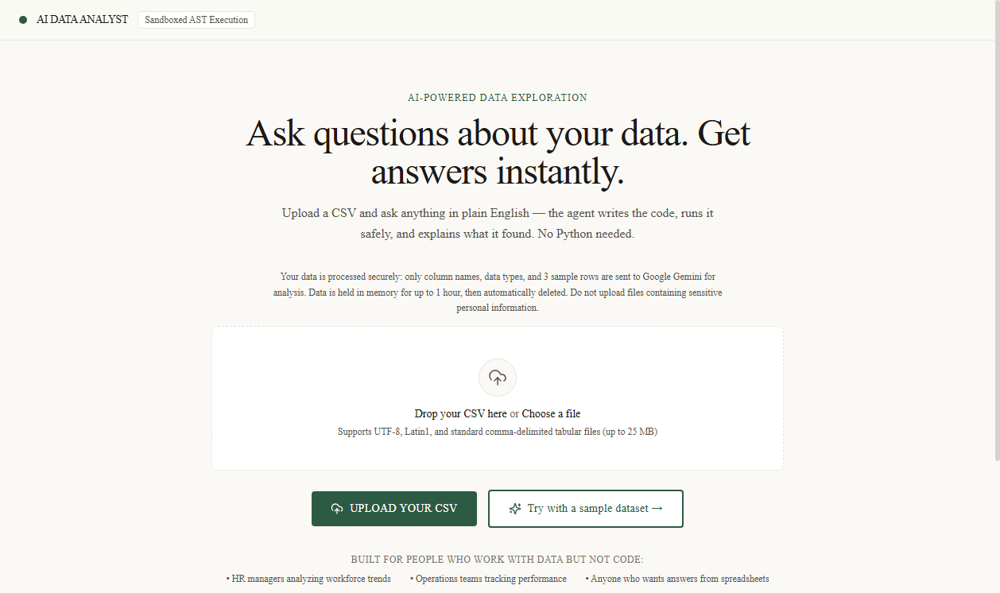
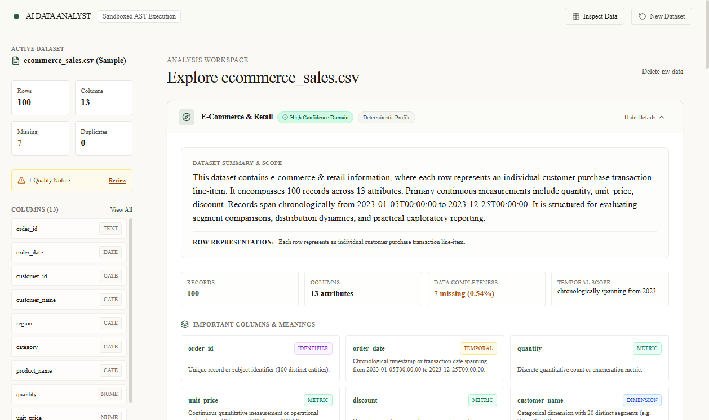

# AI Data Analyst Agent

[](https://github.com/Aashi0105/Ai-data-analyst-agent/actions/workflows/ci.yml)

[](LICENSE)

> An AI-powered analytics tool that lets HR managers, ops teams, and anyone who works with spreadsheets ask plain-English questions about their data — no Python required.

---

## Preview


*Landing page*


*Live result — 131ms to first chart*

---

## What problem does it solve?

Maya is an operations lead who makes daily decisions with spreadsheets, but she is blocked whenever a question requires complex filtering, multi-column groupings, or pivot tables. Today, she either spends hours wrestling with nested spreadsheet formulas or waits days for an engineer or data analyst to write a Python script. With AI Data Analyst Agent, Maya can upload her CSV and ask questions in plain English to get answers, charts, and business interpretations in seconds. Critically, this solves the fundamental trust problem of generative AI in data analytics: instead of presenting "black-box" numbers that could be hallucinations, every answer shows the exact, validated Python/Pandas code that computed it, allowing Maya or her technical teammates to audit the underlying calculations with 100% confidence.

---

## How it works

1. Upload a CSV or use the sample e-commerce dataset for instant one-click demonstration.
2. The agent profiles your data and identifies what questions make sense to ask based on detected columns, types, and distributions.
3. Ask a question in plain English through the natural-language query workspace.
4. The agent generates Pandas code, validates it against a strict AST safety ruleset, and executes it in an isolated sandbox.
5. Results come back with an interactive chart, a plain-English explanation, and the transparent Python code that produced the answer.

---

## Key Features

| Feature | What it does | Why it matters | Status |
| :--- | :--- | :--- | :--- |
| **Natural language analysis** | Converts questions to executable Pandas code via Gemini 2.5 Flash with schema-grounded prompting | No Python needed | ✅ Live |
| **Three-layer safety pipeline** | AST whitelist validation + Windows Job Objects + Linux Docker sandbox | Generated code cannot access files, network, or system resources | ✅ Live |
| **Automatic insight discovery** | Surfaces segment analysis, trends, outliers, and correlations on upload using deterministic Pandas — never LLM-invented numbers | Finds patterns users didn't know to ask about | ✅ Live |
| **Structured explanations** | Returns Finding, Evidence, Interpretation, Limitations, Next Steps per result | Users understand why the answer matters, not just what it is | ✅ Live |
| **Graceful quota handling** | Pre-calculated examples load instantly when AI quota is exhausted; per-session rate limiting prevents one user from using the daily allocation | Tool remains useful even without live AI | ✅ Live |
| **Bounded dataset lifecycle** | TTL expiration, LRU eviction, memory accounting, active-analysis reference counting | Data is never stored permanently | ✅ Live |

---

## Product Metrics

### Success definition
> *"Success is a new visitor reaching a correct, trusted answer within 2 minutes of arrival."*

### Measured results

| Metric | Target | Measured |
| :--- | :--- | :--- |
| **Time to first chart (sample dataset)** | < 10s | 131ms |
| **Test suite coverage** | > 400 tests | 420 passing |
| **Analysis safety** | Zero unsafe code executions | Verified — AST + sandbox blocks all test vectors |
| **Quota resilience** | Tool usable when quota exhausted | ✅ Saved examples load in < 200ms |

### What I'd measure next (if deployed)
- **Upload-to-insight conversion rate:** % of uploaded datasets that lead to at least one successful analysis session.
- **Engagement depth:** Average questions asked per session.
- **Retention signal:** % of users who return within 7 days.

---

## Architecture

```
User Question
     ↓
Schema-Grounded Prompt (column names, dtypes, 3 masked sample rows)
     ↓
Gemini 2.5 Flash → Pandas Code
     ↓
AST Validator (whitelist: no imports, loops, eval, exec, file I/O)
     ↓
Sandbox Execution (Windows Job Objects / Linux Docker)
     ↓
Deterministic Explanation Engine
(Finding → Evidence → Interpretation → Limitations → Next Steps)
     ↓
Result + Chart + Code Audit
```

### Tech Stack

| Layer | Technology |
| :--- | :--- |
| **Frontend** | Next.js, React, TypeScript, Recharts |
| **Backend API** | Python, FastAPI |
| **AI** | Google Gemini 2.5 Flash |
| **Data** | Pandas, NumPy |
| **Security** | AST validation, Windows Job Objects, Linux Docker |
| **Testing** | pytest (420 tests), GitHub Actions CI |

---

## Privacy

> *"Your data is processed securely: only column names, data types, and 3 sample rows are sent to Google Gemini for analysis. Data is held in memory for up to 1 hour, then automatically deleted. Do not upload files containing sensitive personal information."*

Technical details:
- **What is sent to Gemini:** column names, data types, and 3 sample rows (PII-masked before transmission).
- **Storage:** in-memory only, 1-hour TTL, maximum 15 concurrent datasets.
- **Disk:** no dataset files are written to disk permanently.
- **Free tier note:** Google's Gemini free tier terms permit Google to use submitted content to improve its models. Do not submit confidential or sensitive data.

---

## Setup

### Prerequisites
- **Python 3.10+** (Python 3.12 recommended)
- **Node.js 18+** & **npm**
- **Git**

### 1. Clone the Repository
```bash
git clone https://github.com/Aashi0105/Ai-data-analyst-agent.git
cd Ai-data-analyst-agent
```

### 2. Backend Setup
Create a virtual environment and install dependencies:
- **On Windows (PowerShell):**
  ```powershell
  python -m venv venv
  .\venv\Scripts\Activate.ps1
  pip install -r requirements.txt
  ```
- **On macOS / Linux:**
  ```bash
  python3 -m venv venv
  source venv/bin/activate
  pip install -r requirements.txt
  ```

Configure environment variables:
```bash
cp .env.example .env
```
Edit `.env` and add your Google Gemini API key:
```env
GEMINI_API_KEY=your_actual_gemini_api_key_here
```
*(Get a free Gemini API key from [Google AI Studio](https://aistudio.google.com/)).*

Launch the FastAPI backend:
```bash
uvicorn backend.main:app --port 8000
```
- API endpoint: `http://localhost:8000`
- Swagger UI docs: `http://localhost:8000/docs`

### 3. Frontend Setup
In a second terminal window:
```bash
cd frontend
npm install
```

Configure frontend environment variables:
```bash
cp .env.example .env.local
```
*(Defaults to `NEXT_PUBLIC_API_URL=http://localhost:8000`).*

Start the development server:
```bash
npm run dev
```
Open your browser and navigate to `http://localhost:3000`.

---

## Known Limitations

| Limitation | Detail |
| :--- | :--- |
| **Shared quota** | Free Gemini tier: ~20 requests/day shared across all users. Per-session limit of 5 analyses. |
| **Single worker** | In-memory store is not suitable for concurrent production deployment across multiple workers. |
| **No authentication** | Anyone with the URL can upload data. Not suitable for sensitive or confidential datasets. |
| **In-memory only** | Data is lost on server restart. No persistent storage. |
| **CSV only** | Does not support Excel, SQL databases, JSON, or other formats in the current version. |

---

## What I'd Build Next

1. **SQL database connection** — Most business data lives in databases, not CSV files. Connecting directly to PostgreSQL or MySQL would remove the export step entirely.

2. **Saved analysis history** — Users currently lose their previous questions when they close the browser. Session persistence would let them build on previous analyses and share findings with colleagues.

3. **Multi-user authentication** — The current tool is demo-grade. Adding login would enable teams to share datasets securely and track individual usage, making the tool suitable for real organizational deployment.

---

## Running Tests

Run the test suite locally:
```bash
pytest tests/ -k "not test_docker_real_container" -v
```

*Verified result:* **420 passed, 0 failed, 3 deselected**.

Tests cover AST validation, sandbox execution, API endpoints, dataset lifecycle, automatic insights, analytical explanations, and product metrics logging.

---

## License

This project is licensed under the terms of the [MIT License](LICENSE).
