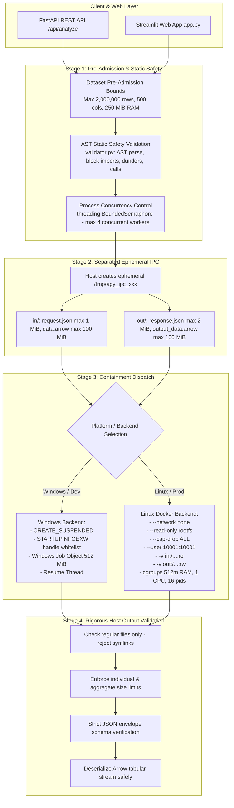

# AI Data Analyst Agent — Execution Sandbox Architecture & Containment Specification

## Overview
This document specifies the dual-layer, cross-platform containment architecture for the AI Data Analyst Agent. The system provides defensible, multi-layered isolation for executing AI-generated Python/pandas analytics code across both Windows (development/native runtime) and Linux (containerized production runtime).

---

## 1. Multi-Layer Defense Architecture



---

## 2. Separated IPC Permissions & Host Validation

### 2.1 Storage Separation
Generated worker code does **not** share an unrestricted read/write directory with the host:
- **`in/` (Read-Only Mount):** The host writes `request.json` and `input_data.arrow`. Mounted into Docker as `:ro` (`/workspace/ipc/in:ro`). The child container cannot modify, truncate, append to, or delete input files.
- **`out/` (Narrowly Scoped Writable Mount):** Mounted into Docker as `:rw` (`/workspace/ipc/out:rw`). The child container is only permitted to write its output artifacts (`response.json` and `output_data.arrow`) here.
- **`/tmp` (Scratch):** Mounted as `tmpfs:rw,noexec,nosuid,size=64m`. Any temporary files written to `/tmp` reside strictly in ephemeral container RAM and cannot be executed as binaries.

### 2.2 Host-Side Validation Before Ingestion
Before the host API process opens or reads any file produced by the worker:
1. **Symlink Rejection:** Checks `os.path.islink()`. If `response.json` or `output_data.arrow` is a symbolic link, execution **fails closed** immediately. This completely neutralizes path-traversal attacks attempting to read host secret files (e.g. `/etc/shadow`, `.env`, SSH keys).
2. **Regular File Verification:** Verifies `os.path.isfile()` and rejects directories, FIFOs, unix domain sockets, and character/block devices.
3. **Pre-Read Size Bounds:** Verifies `os.path.getsize(resp_path) <= 2 MiB` and `os.path.getsize(output_arrow_path) <= 100 MiB` before any byte reading or memory-mapping occurs.
4. **Aggregate Directory Budget:** Sums all files in `out/` to guarantee total storage $\le 250\text{ MiB}$.

---

## 3. Linux Docker Containment Specification

For Linux deployments, execution is contained inside an ephemeral, single-use Docker container per analysis query.

### 3.1 Hardened Container Invocation Flags
```bash
docker run \
  --rm \
  --name sandbox_worker_<unique_id> \
  --network none \
  --read-only \
  --cap-drop ALL \
  --security-opt no-new-privileges:true \
  --user 10001:10001 \
  --memory=512m \
  --memory-swap=512m \
  --cpus=1.0 \
  --pids-limit=16 \
  --tmpfs /tmp:rw,noexec,nosuid,size=64m \
  -v /tmp/agy_ipc_xxx/in:/workspace/ipc/in:ro \
  -v /tmp/agy_ipc_xxx/out:/workspace/ipc/out:rw \
  --stop-timeout=5 \
  ai-data-analyst-sandbox:latest \
  python -u /workspace/sandbox_worker.py \
    --in-dir /workspace/ipc/in \
    --out-dir /workspace/ipc/out
```

### 3.2 Security Properties
- **Complete Network Isolation (`--network none`):** Disables all network namespaces except loopback. Reverse shells, socket connections, metadata service probes (`169.254.169.254`), and data exfiltration fail with `Network is unreachable`.
- **Read-Only Root Filesystem (`--read-only`):** Disallows modifying system libraries, installing packages, or creating persistent backdoor binaries.
- **Unprivileged Execution (`--user 10001:10001`, `--cap-drop ALL`, `--security-opt no-new-privileges:true`):** Worker executes as an unprivileged user without any Linux capabilities. Setuid privilege escalation binaries are completely disabled.
- **Cgroups Resource Ceilings:**
  - Memory: $512\text{ MiB}$ hard ceiling; `--memory-swap=512m` prevents disk thrashing or swap exhaustion.
  - Process limit: `--pids-limit=16` prevents fork-bomb attacks from crashing the host kernel.
  - CPU quota: `--cpus=1.0` prevents CPU monopolization.
- **Timeout and Deterministic Cleanup:** The host waits up to `DEFAULT_TIMEOUT_SECONDS` ($5.0\text{s}$). If expired, the host runs `docker kill` and `docker rm -f`, ensuring zero orphaned containers.

---

## 4. Host Protection and Docker Daemon Privilege Risks

> [!WARNING]
> **Host Security Notice:** The API host process communicates with the local Docker daemon. To protect the host:
> 1. The Docker socket (`/var/run/docker.sock`) is **NEVER** mounted into or exposed to worker containers.
> 2. For production cloud deployments, running **Rootless Docker** is strongly recommended so the Docker daemon itself runs without host root privileges.
> 3. If standard Docker is used, placing an API socket proxy (e.g., `Tecativa/docker-socket-proxy`) between the API and the daemon with a strict endpoint allowlist (`POST /containers/create`, `POST /containers/{id}/start`, `POST /containers/{id}/kill`, `DELETE /containers/{id}`) prevents host reconfiguration even if the API server was compromised.

---

## 5. Fail-Closed Security Policy

- **No Unsafe Fallbacks:** If the configured isolation backend (e.g. Docker on Linux) is unavailable or the daemon is unreachable, execution is **strictly rejected**.
- The system **never** falls back to executing untrusted Python in the host API process or unconstrained host subprocesses on Linux.

---

## 6. Deployment Requirements & Cloud Hosting Compatibility

### Recommended Environments:
- **Standard Linux VPS / Cloud VM:** Ubuntu 22.04/24.04 LTS (DigitalOcean Droplet, Hetzner Cloud, AWS EC2, GCP Compute Engine).
  - Requires standard Docker Engine (`docker-ce`) installed and accessible to the API runner.
  - Sibling container execution (Docker-outside-of-Docker) functions natively.

### Incompatible Environments:
- **Serverless Edge / Static Web Platforms (e.g. basic Vercel, Render static web services):** These environments lack Docker daemon access or nested containerization capabilities and cannot run container-isolated workers.

---

## 7. Residual Risks & Stronger Boundaries

- **Shared Kernel Attack Surface:** Docker container isolation shares the underlying Linux host kernel. A kernel vulnerability (such as a privilege escalation CVE in a system call) could theoretically be exploited for container breakout.
- **Portfolio vs Commercial Boundary:**
  - For this portfolio project, Docker with `--network none`, `--read-only`, `--cap-drop ALL`, and separated IPC represents a production-grade, defensible engineering standard.
  - For a high-threat, multi-tenant public commercial platform (e.g., AWS Lambda, Modal, Replit), hypervisor-level virtualization with dedicated guest kernels (such as **AWS Firecracker microVMs**) or userspace kernel interception (**Google gVisor / `runsc`**) is required.
