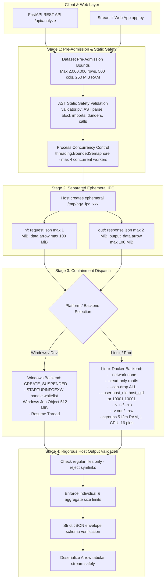

# AI Data Analyst Agent — Execution Sandbox Architecture & Containment Specification

## Overview
This document specifies the dual-layer, cross-platform containment architecture for the AI Data Analyst Agent. The system provides defensible, multi-layered isolation for executing AI-generated Python/pandas analytics code across both Windows (development/native runtime) and Linux (containerized production runtime).

---

## 1. Multi-Layer Defense Architecture



---

## 2. Separated IPC Permissions & Host Validation

### 2.1 Storage Separation
Generated worker code does **not** share an unrestricted read/write directory with the host:
- **`in/` (Read-Only Mount):** The host writes `request.json` and `input_data.arrow`. Mounted into Docker as `:ro` (`/workspace/ipc/in:ro`). The child container cannot modify, truncate, append to, or delete input files.
- **`out/` (Narrowly Scoped Writable Mount):** Mounted into Docker as `:rw` (`/workspace/ipc/out:rw`). The child container is only permitted to write its output artifacts (`response.json` and `output_data.arrow`) here.
- **`/tmp` (Scratch):** Mounted as `tmpfs:rw,noexec,nosuid,size=64m`. Any temporary files written to `/tmp` reside strictly in ephemeral container RAM and cannot be executed as binaries.

### 2.2 IPC Ownership Resolution & Least-Privilege Permissions
Rather than assuming a fixed container UID or relying on fragile, permissive modes (`0o777` or sticky `0o1777`), the execution sandbox resolves filesystem ownership defensively based on host execution identity:

1. **Host Identity Alignment (Primary Path):**
   - When the host runs as an unprivileged user (`os.getuid() != 0`), the container user is dynamically set to `f"{os.getuid()}:{os.getgid()}"`.
   - The parent IPC directory is set to `0o700` owned by the host process, completely preventing access by other host users.
   - The `in/` directory is set to `0o700` (`0o600` on input files) and mounted `:ro` inside the container.
   - The `out/` directory is set to `0o700` owned by the host user and mounted `:rw`.
   - Because the worker process inside the container runs under the identical UID/GID, it can write its outputs directly to `out/` without requiring permissive modes (`0o777`/`0o1777`), recursive `chown`, or POSIX ACLs. Host post-run cleanup via `shutil.rmtree` succeeds natively without permission denied errors.
2. **Root Host Fallback (CI / Privileged Host):**
   - When the host process runs as `root` (`os.getuid() == 0`), the container worker is explicitly constrained to non-root user `10001:10001`.
   - The host root process chowns `out/` to `10001:10001` with strict `0o700` mode. Input files in `in/` are made readable (`0o755`/`0o644`) and mounted `:ro`.
3. **Environment Override:**
   - Operators can set `SANDBOX_DOCKER_USER` to an explicit `uid:gid` string (e.g. `1000:1000` or `10001:10001`) if custom container mapping is desired.
4. **Fail-Closed Security Guarantee:**
   - If a mismatched unprivileged identity cannot be safely reconciled (e.g. host UID 1000 running container as 10001 without root privileges or POSIX ACL support), execution **fails closed** with a detailed diagnostic error. The system strictly rejects falling back to world-writable `0o777` or `0o1777` permissions.

### 2.3 Supported vs. Unverified Runtime Configurations

| Runtime Configuration | Status | Behavior & Verification |
| :--- | :--- | :--- |
| **Linux Host (Unprivileged) + Rootful Docker (Standard)** | **Supported & Verified Architecture** | Host user is in the `docker` group with standard rootful Docker Engine (no daemon `userns-remap`). Container runs as `--user <host_uid>:<host_gid>`. All IPC directories are strict `0o700` (`0o600` input files). Host process and container process share the identical kernel UID/GID, guaranteeing safe writes, safe reads, and unhindered host cleanup. |
| **Linux Host (Root) + Rootful Docker** | **Supported & Verified Architecture** | Host runs as root (e.g. CI runner or bare privileged container). Container is constrained to non-root `10001:10001`, and host root chowns `out/` to `10001:10001` with `0o700`. Root cleans up cleanly. |
| **Rootless Docker (`dockerd-rootless.sh`)** | **Unsupported / Unverified** | In Rootless Docker, the daemon executes inside a user namespace where container root (UID 0) maps to the unprivileged host user (`host_uid`), while non-root container UIDs map to subordinate host UIDs from `/etc/subuid` (e.g. `subuid_start + UID - 1`). Executing with `--user <host_uid>:<host_gid>` causes the kernel to treat container writes as an unmapped subordinate UID which is denied write access to `0o700` host directories owned by `host_uid`. Running worker code as container root (`--user 0:0`) to circumvent this is strictly rejected by policy. Until a dedicated subuid mapping and mount-permission strategy is validated via live integration tests, Rootless Docker is unsupported. |
| **Rootful Docker with User-Namespace Remapping (`userns-remap`)** | **Unsupported / Unverified** | When `/etc/docker/daemon.json` enables `"userns-remap"`, container UIDs map to subordinate ID ranges (e.g., `165536 + host_uid`). A container running as `--user <host_uid>` cannot write to `0o700` host directories owned by `host_uid` without explicit subordinate UID chown/ACLs. This configuration remains unverified and unsupported out of the box. |
| **Windows Native Development** | **Supported** | Bypasses POSIX chmod/chown; relies on Windows Job Object kernel limits and handle inheritance whitelist. |

### 2.4 Host-Side Validation Before Ingestion
Before the host API process opens or reads any file produced by the worker:
1. **Symlink Rejection:** Checks `os.path.islink()`. If `response.json` or `output_data.arrow` is a symbolic link, execution **fails closed** immediately. This completely neutralizes path-traversal attacks attempting to read host secret files (e.g. `/etc/shadow`, `.env`, SSH keys).
2. **Regular File Verification:** Verifies `os.path.isfile()` and rejects directories, FIFOs, unix domain sockets, and character/block devices.
3. **Pre-Read Size Bounds:** Verifies `os.path.getsize(resp_path) <= 2 MiB` and `os.path.getsize(output_arrow_path) <= 100 MiB` before any byte reading or memory-mapping occurs.
4. **Aggregate Directory Budget:** Sums all files in `out/` to guarantee total storage $\le 250\text{ MiB}$.

---

## 3. Linux Docker Containment Specification

For Linux deployments, execution is contained inside an ephemeral, single-use Docker container per analysis query.

### 3.1 Hardened Container Invocation Flags

```bash
# Mandatory local image build:
docker build -t ai-data-analyst-sandbox:latest -f Dockerfile.sandbox .

# Ephemeral runtime execution:
docker run \
  --rm \
  --name sandbox_worker_<unique_id> \
  --network none \
  --read-only \
  --cap-drop ALL \
  --security-opt no-new-privileges:true \
  --user <host_uid>:<host_gid> \
  --memory=512m \
  --memory-swap=512m \
  --cpus=1.0 \
  --pids-limit=16 \
  --tmpfs /tmp:rw,noexec,nosuid,size=64m \
  -v /tmp/agy_ipc_xxx/in:/workspace/ipc/in:ro \
  -v /tmp/agy_ipc_xxx/out:/workspace/ipc/out:rw \
  --stop-timeout=5 \
  --pull=never \
  ai-data-analyst-sandbox:latest \
  --in-dir /workspace/ipc/in \
  --out-dir /workspace/ipc/out
```

### 3.2 Security Properties
- **Complete Network Isolation (`--network none`):** Disables all network namespaces except loopback. Reverse shells, socket connections, metadata service probes (`169.254.169.254`), and data exfiltration fail with `Network is unreachable`.
- **Read-Only Root Filesystem (`--read-only`):** Disallows modifying system libraries, installing packages, or creating persistent backdoor binaries.
- **Unprivileged Execution (`--user <host_uid>:<host_gid>`, `--cap-drop ALL`, `--security-opt no-new-privileges:true`):** Worker executes as an unprivileged user without any Linux capabilities. Setuid privilege escalation binaries are completely disabled.
- **Explicit Image Pinning & No Pulls (`--pull=never`):** Prevents the Docker daemon from querying external public registries (e.g. Docker Hub) if the local image is missing. Execution fails closed if the verified image has not been built locally.
- **Cgroups Resource Ceilings:**
  - Memory: $512\text{ MiB}$ hard ceiling; `--memory-swap=512m` prevents disk thrashing or swap exhaustion.
  - Process limit: `--pids-limit=16` prevents fork-bomb attacks from crashing the host kernel.
  - CPU quota: `--cpus=1.0` prevents CPU monopolization.
- **Timeout and Deterministic Cleanup:** The host waits up to `DEFAULT_TIMEOUT_SECONDS` ($5.0\text{s}$). If expired, the host runs `docker kill` and `docker rm -f`, ensuring zero orphaned containers. Clean exits (`code 0`) are auto-removed by `--rm`.

---

## 4. Host Protection and Docker Daemon Privilege Risks

> [!WARNING]
> **Host Security Notice & Socket Proxy Limitations:** The API host process communicates with the local Docker daemon. To protect the host:
> 1. The Docker socket (`/var/run/docker.sock`) is **NEVER** mounted into or exposed to worker containers.
> 2. **Socket Proxy Warning:** An ordinary HTTP endpoint allowlist alone (e.g. `Tecativa/docker-socket-proxy` allowlisting `POST /containers/create`) is **NOT** an adequate host-security boundary on its own. Endpoint path filtering checks the URL path but does not inspect the request body: an attacker with API server access could send a request to `/containers/create` specifying arbitrary host filesystem bind mounts (`{"Binds": ["/:/host"], "Privileged": true}`) and achieve full host takeover.
> 3. **Production Boundaries & Isolation Constraints:**
>    - **User-Namespace Limitation:** While Rootless Docker and daemon `userns-remap` isolate daemon privileges, user-namespace UID remapping causes `--user <host_uid>` writes to fail against `0o700` host bind mounts unless complex subordinate UID mappings are configured. Until a concrete subuid mapping and mount-permission strategy is validated via live integration testing, these configurations are unsupported out of the box. Running worker code as container root (`--user 0:0`) to bypass permission problems is strictly rejected by policy.
>    - **Recommended Production Boundary:** Dedicated, single-tenant worker hosts/VMs running standard Docker Engine, or hypervisor-level isolation (e.g. AWS Firecracker microVMs) with dedicated guest kernels.
>    - Alternatively, use an AuthZ policy filter (e.g. Open Policy Agent) that validates JSON request bodies to disallow any mounts outside `/tmp/agy_ipc_*`.
>    - Or isolate execution in a dedicated, narrowly scoped worker microservice running on a separate host/VM.

---

## 5. Fail-Closed Security Policy

- **No Unsafe Fallbacks:** If the configured isolation backend (e.g. Docker on Linux) is unavailable or the daemon is unreachable, execution is **strictly rejected**.
- The system **never** falls back to executing untrusted Python in the host API process or unconstrained host subprocesses on Linux.

---

## 6. Deployment Requirements & Cloud Hosting Compatibility

### Recommended Environments:
- **Standard Linux VPS / Cloud VM:** Ubuntu 22.04/24.04 LTS (DigitalOcean Droplet, Hetzner Cloud, AWS EC2, GCP Compute Engine).
  - Requires standard Docker Engine (`docker-ce`) installed and accessible to the API runner.
  - Sibling container execution (Docker-outside-of-Docker) functions natively.

### Process Concurrency & ASGI Model:
- **Process-Local Concurrency:** The concurrency limiter (`threading.BoundedSemaphore`) is strictly **process-local**. In a multi-worker ASGI deployment (e.g. `uvicorn --workers 4` or Gunicorn with 4 workers), each worker process maintains an independent semaphore, allowing up to $4 \times \text{max\_concurrent\_workers}$ simultaneous containers.
- **Deployment Requirement:** For this portfolio demo, the FastAPI server must be run with a single worker process:
  ```bash
  uvicorn backend.main:app --workers 1 --port 8000
  ```
- In high-scale multi-worker production systems, cross-process coordination (e.g., POSIX file locks via `fcntl.flock` or an external Redis semaphore) should be implemented.

### Incompatible Environments:
- **Serverless Edge / Static Web Platforms (e.g. basic Vercel, Render static web services):** These environments lack Docker daemon access or nested containerization capabilities and cannot run container-isolated workers.

---

## 7. Residual Risks & Stronger Boundaries

- **Shared Kernel Attack Surface:** Docker container isolation shares the underlying Linux host kernel. A kernel vulnerability (such as a privilege escalation CVE in a system call) could theoretically be exploited for container breakout.
- **Portfolio vs Commercial Boundary:**
  - For this portfolio project, Docker with `--network none`, `--read-only`, `--cap-drop ALL`, `--pull=never`, and separated IPC represents a production-grade, defensible engineering standard.
  - For a high-threat, multi-tenant public commercial platform (e.g., AWS Lambda, Modal, Replit), hypervisor-level virtualization with dedicated guest kernels (such as **AWS Firecracker microVMs**) or userspace kernel interception (**Google gVisor / `runsc`**) is required.
