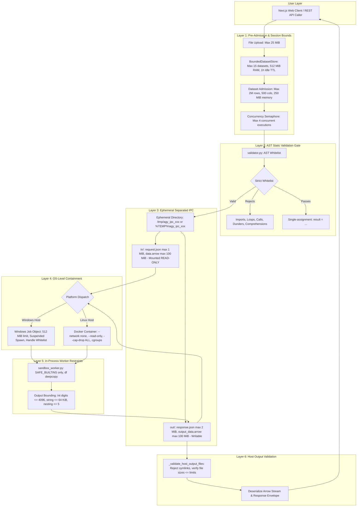

# AI Data Analyst Agent — Security Architecture & Verification Specification

> **Verified Security Controls, Execution Boundaries, Test Evidence, and Threat Model**
> *Source of Truth: System implementation in `validator.py`, `sandbox.py`, `sandbox_worker.py`, `backend/store.py`, and test evidence in `tests/`.*

---

## 1. Executive Summary & Security Model

The **AI Data Analyst Agent** executes AI-generated Python/Pandas code against user-provided CSV datasets. Because Large Language Models (LLMs) can produce arbitrary, hallucinated, or adversarial code snippets, executing generated code poses severe security risks if unbounded.

To defend against arbitrary code execution, denial of service (DoS), data exfiltration, and host file system tampering, the system implements a **multi-layered, defense-in-depth architecture**:



> [!IMPORTANT]
> **Fundamental Distinction: Code Validation vs. Sandbox Isolation**
> - **AST Static Code Validation (`validator.py`)** is a syntactic filter operating on the Python AST before execution. It prevents obviously dangerous syntax (e.g. `import os`, `eval()`, loop constructs, classes, dunder traversal). However, static AST validation is **not an OS sandbox**: it does not control kernel memory allocations, thread lifecycles, or host resource monopolization.
> - **Runtime Sandbox Containment (`sandbox.py`)** is the OS-level isolation boundary. It executes code in an isolated subprocess under hard wall-clock timeouts, memory limits, and platform-specific isolation (Windows Job Objects on Windows; hardened Docker containers on Linux). Runtime containment guarantees that even if a construct were to pass AST checks, the process cannot exceed resource ceilings, execute network calls, or survive past its deadline.

---

## 2. System Execution Flow

The end-to-end execution path from user question to result visualization follows seven sequential stages:

1. **Session & Ingestion (`backend/main.py`, `backend/store.py`):**
   - The user uploads a CSV (`POST /api/datasets/upload`) or accesses an existing session.
   - The file is read in 1 MiB chunks up to the strict 25 MiB upload ceiling (`MAX_UPLOAD_SIZE_MB`).
   - The dataset is stored in `BoundedDatasetStore` with deep memory tracking (`df.memory_usage(deep=True)`).
   - When an analytical query arrives (`POST /api/analyze`), `acquire_active(dataset_id)` context manager is entered, incrementing `active_queries` to protect the dataset from LRU eviction or deletion while yielding outside the store lock.
2. **AI Code Generation (`agent.py`):**
   - The agent serializes the schema and 3 sample rows with heuristic PII redaction and 30-character string truncation.
   - Google Gemini (`gemini-2.5-flash`) generates Python Pandas code targeting the user question at temperature `0.1`.
   - `clean_code()` strips markdown code fences (````python ... ````). Bare expressions are normalized to assign to `result`.
3. **AST Safety Gate (`validator.py`):**
   - Code is parsed into an Abstract Syntax Tree via `ast.parse()`.
   - Every node is matched against `ALLOWED_NODE_TYPES`.
   - Identifiers and attributes are matched against `FORBIDDEN_NAMES`.
   - Dunder attributes (`node.attr.startswith("__")`) are blocked.
   - Extreme constant exponentiations (`**`) are bounded.
   - Exactly one assignment to `result` is verified.
4. **Pre-Admission & Ephemeral IPC Setup (`sandbox.py`):**
   - Concurrency bounded via `threading.BoundedSemaphore(MAX_CONCURRENT_WORKERS)` (default 4).
   - Code size checked: $\le 512\text{ KiB}$.
   - Input rows ($\le 2,000,000$) and columns ($\le 500$) verified.
   - Memory admission checked: $\le 250\text{ MiB}$.
   - Ephemeral directory created (`agy_ipc_<uuid>`) with isolated `in/` and `out/` subdirectories.
   - `request.json` ($\le 1\text{ MiB}$) and `input_data.arrow` ($\le 100\text{ MiB}$) written to `in/`.
5. **Subprocess Isolation & Containment (`sandbox.py`):**
   - **Windows:** Suspended process creation (`CREATE_SUSPENDED`), assigned to a `WindowsJobObject` with 512 MiB limit and handle whitelist (`STARTUPINFOEXW` whitelisting only `NUL`), then resumed.
   - **Linux:** Ephemeral Docker container with `--network none`, `--read-only`, `--cap-drop ALL`, non-root user, cgroups limits (512m RAM, 1 CPU, 16 PIDs), `in/` mounted `:ro`, `out/` mounted `:rw`.
6. **Worker Execution (`sandbox_worker.py`):**
   - Reads input Arrow stream.
   - Copies DataFrame deeply (`df.copy(deep=True)`).
   - Executes with restricted `__builtins__` (`SAFE_BUILTINS` only; 22 safe functions).
   - Enforces bounds on `result`: integer digits $\le 4,096$, strings $\le 64\text{ KiB}$, aggregate string bytes $\le 1\text{ MiB}$, nesting depth $\le 5$, collection items $\le 10,000$. Rejects non-finite floats (`inf`, `-inf`).
   - Writes `response.json` ($\le 2\text{ MiB}$) and `output_data.arrow` ($\le 100\text{ MiB}$) to `out/`.
7. **Host Output Validation & Result Return (`sandbox.py`, `backend/main.py`):**
   - Host inspects `out/` files before reading: rejects symlinks, verifies file sizes and directory totals ($\le 250\text{ MiB}$).
   - Deserializes result safely via PyArrow stream.
   - Formats visualization data via `build_recharts_data` and returns `AnalyzeResponse`.

---

## 3. AST Validator Specification (`validator.py`)

The AST validator enforces a strict structural whitelist. Any AST construct not explicitly permitted is rejected fail-closed.

### 3.1 Allowed AST Node Types (`ALLOWED_NODE_TYPES`)

| Category | Allowed AST Constructs |
| :--- | :--- |
| **Structure** | `ast.Module`, `ast.Expr`, `ast.Assign`, `ast.AugAssign`, `ast.AnnAssign` |
| **Expressions** | `ast.Attribute`, `ast.Call`, `ast.Subscript`, `ast.Name`, `ast.Constant` |
| **Collections** | `ast.List`, `ast.Tuple`, `ast.Dict`, `ast.Set`, `ast.Slice`, `ast.keyword` |
| **Contexts** | `ast.Load`, `ast.Store`, `ast.Index` (Python < 3.9) |
| **Operators** | `ast.BinOp`, `ast.UnaryOp`, `ast.BoolOp`, `ast.Compare` |
| **Arithmetic Operators** | `Add`, `Sub`, `Mult`, `Div`, `FloorDiv`, `Mod`, `Pow`, `MatMult`, `BitOr`, `BitXor`, `BitAnd`, `LShift`, `RShift` |
| **Unary / Logical Operators** | `UAdd`, `USub`, `Not`, `Invert`, `And`, `Or` |
| **Comparison Operators** | `Eq`, `NotEq`, `Lt`, `LtE`, `Gt`, `GtE`, `Is`, `IsNot`, `In`, `NotIn` |

### 3.2 Explicitly Rejected Constructs & User Messages

| Disallowed Syntax | AST Node Type | Enforced Diagnostic / Message |
| :--- | :--- | :--- |
| **Imports** | `ast.Import`, `ast.ImportFrom` | `"Import statements are not allowed."` |
| **Functions** | `ast.FunctionDef`, `ast.AsyncFunctionDef` | `"Function definitions are not allowed."` |
| **Classes** | `ast.ClassDef` | `"Class definitions are not allowed."` |
| **Lambdas** | `ast.Lambda` | `"Lambda expressions are not allowed."` |
| **Loops** | `ast.While`, `ast.For`, `ast.AsyncFor` | `"Loops are not allowed."` |
| **Comprehensions** | `ast.ListComp`, `ast.DictComp`, `ast.SetComp`, `ast.GeneratorExp` | `"Unsafe construct '<Type>' is not allowed."` |
| **F-Strings** | `ast.JoinedStr`, `ast.FormattedValue` | `"Unsafe construct '<Type>' is not allowed."` |
| **Walrus Operator** | `ast.NamedExpr` (`:=`) | `"Unsafe construct 'NamedExpr' is not allowed."` |
| **Exception Handling** | `ast.Try` | `"Try/Except blocks are not allowed."` |
| **Context Managers** | `ast.With`, `ast.AsyncWith` | `"With statements are not allowed."` |
| **Control Flow** | `ast.Assert`, `ast.Delete`, `ast.Pass`, `ast.Return`, `ast.Raise` | `"Unsafe construct '<Type>' is not allowed."` |
| **Generators & Async** | `ast.Yield`, `ast.YieldFrom`, `ast.Await` | `"Generators and async code are not allowed."` |
| **Scope Mutators** | `ast.Global`, `ast.Nonlocal` | `"Global statements are not allowed."` |
| **Pattern Matching** | `ast.Match` | `"Unsafe construct 'Match' is not allowed."` |

### 3.3 Forbidden Identifiers & Attributes (`FORBIDDEN_NAMES`)

The validator checks all `ast.Name(id=...)` and `ast.Attribute(attr=...)` nodes against `FORBIDDEN_NAMES`:

1. **System & Process Execution:** `exec`, `eval`, `open`, `compile`, `globals`, `locals`, `vars`, `input`, `exit`, `quit`, `__import__`, `os`, `sys`, `subprocess`, `socket`, `shutil`, `pathlib`, `pickle`, `requests`, `urllib`, `http`.
2. **Reflection & Dynamic Dispatch:** `getattr`, `hasattr`, `setattr`, `delattr`.
3. **Pandas/NumPy File & Network I/O:** `read_csv`, `to_csv`, `read_pickle`, `to_pickle`, `read_parquet`, `to_parquet`, `read_excel`, `to_excel`, `read_sql`, `to_sql`, `read_sql_query`, `read_sql_table`, `read_feather`, `to_feather`, `read_hdf`, `to_hdf`, `read_json`, `to_json`, `read_html`, `to_html`, `read_xml`, `to_xml`, `read_clipboard`, `to_clipboard`, `read_stata`, `to_stata`, `read_spss`, `read_sas`, `read_orc`, `to_orc`, `read_gbq`, `to_gbq`, `read_table`, `read_fwf`.
4. **NumPy File I/O & Memory Mapping:** `fromfile`, `tofile`, `load`, `save`, `savez`, `savez_compressed`, `loadtxt`, `savetxt`, `genfromtxt`, `fromregex`, `memmap`.
5. **Dynamic Expression Evaluation:** `query`, `pipe`.
6. **Private and Dunder Attributes:** Any attribute starting with `__` (e.g., `__class__`, `__dict__`, `__subclasses__`) triggers `"Private or dunder attributes are not allowed."`.

### 3.4 Invariant & Static Resource Rules

- **Result Invariant:** Code must assign to the variable `result` exactly once. Unpacking to tuple targets (e.g. `result, x = (1, 2)`) or multiple assignments (e.g. `result = 1; result += 2`) are rejected.
- **Static Exponentiation Bounds:** Guard against memory/CPU exhaustion via static big-int calculation:
  - Base limit: $|base| \le 100,000$. Exceeding triggers `"Exponentiation base exceeds safe limit (max 100,000)."`.
  - Power limit: $|power| \le 1,000$. Exceeding triggers `"Exponentiation power exceeds safe limit (max 1000)."`.

---

## 4. Execution Containment Environments

### 4.1 Windows Containment (Native Runtime)

On Windows hosts, execution uses Windows Job Objects and low-level Win32 APIs:

- **Kernel Job Object Creation (`CreateJobObjectW`):**
  - Limit flags configured via `SetInformationJobObject` with `JOBOBJECT_EXTENDED_LIMIT_INFORMATION`:
    * `JOB_OBJECT_LIMIT_KILL_ON_JOB_CLOSE (0x2000)`: Automatically terminates the worker and all descendant processes when the job object handle closes.
    * `JOB_OBJECT_LIMIT_ACTIVE_PROCESS (0x08)`: Caps concurrent active processes to `SANDBOX_WORKER_PROCESSES` (default 16; tests verify active process containment).
    * `JOB_OBJECT_LIMIT_PROCESS_MEMORY (0x100)` & `JOB_OBJECT_LIMIT_JOB_MEMORY (0x200)`: Hard virtual memory commit limit set to `SANDBOX_WORKER_MEMORY_BYTES` (default 512 MiB).
- **Suspended Process Creation (`_spawn_suspended_windows_process`):**
  - Worker is spawned with `CREATE_SUSPENDED (0x04)`.
  - **Explicit Handle Inheritance Whitelist (`STARTUPINFOEXW`):**
    * Standard handles (`hStdInput`, `hStdOutput`, `hStdError`) are bound to `NUL` with `bInheritHandle = True`.
    * `InitializeProcThreadAttributeList` and `UpdateProcThreadAttribute` with `_PROC_THREAD_ATTRIBUTE_HANDLE_LIST` explicitly whitelist *only* the `NUL` handle.
    * Arbitrary file handles, sockets, or pipes open in the parent process cannot be inherited by the child.
  - The suspended process is assigned to the Job Object via `AssignProcessToJobObject` *before* execution begins.
  - The main thread is resumed with `ResumeThread` only after assignment succeeds. If assignment fails, the process is terminated immediately without executing code.
- **Environment Sanitization (`_get_safe_env`):**
  - Explicit whitelist: `SYSTEMROOT`, `SYSTEMDRIVE`, `WINDIR`, `COMSPEC`, `PATH`, `PATHEXT`, `TEMP`, `TMP`, `PYTHONIOENCODING`, `PYTHONUTF8`.
  - Strictly omits API keys, tokens, database credentials, and host secrets.

### 4.2 Linux Containment (Docker Runtime)

On Linux hosts, execution is contained inside a dedicated, ephemeral single-use Docker container:

```bash
docker run \
  --rm \
  --name sandbox_worker_<unique_id> \
  --network none \
  --read-only \
  --cap-drop ALL \
  --security-opt no-new-privileges:true \
  --user <host_uid>:<host_gid> \
  --memory=512m \
  --memory-swap=512m \
  --cpus=1.0 \
  --pids-limit=16 \
  --tmpfs /tmp:rw,noexec,nosuid,size=64m \
  -v /tmp/agy_ipc_xxx/in:/workspace/ipc/in:ro \
  -v /tmp/agy_ipc_xxx/out:/workspace/ipc/out:rw \
  --stop-timeout=5 \
  --pull=never \
  ai-data-analyst-sandbox:latest \
  --in-dir /workspace/ipc/in \
  --out-dir /workspace/ipc/out
```

- **Network Isolation (`--network none`):** No network interface except loopback. Outbound connections, reverse shells, and exfiltration attempts fail with `Network is unreachable`.
- **Read-Only Root Filesystem (`--read-only`):** System libraries and binaries cannot be modified.
- **Capabilities Dropped (`--cap-drop ALL`):** Drops all Linux capabilities (no raw sockets, no chroot, no ptrace, no administrative capabilities).
- **No Privilege Escalation (`--security-opt no-new-privileges:true`):** Prevents setuid binaries from escalating privileges.
- **Local Image Pinning (`--pull=never`):** Fails closed if the image is missing locally; never queries public registries.
- **RAM Scratchpad (`--tmpfs /tmp`):** Narrow 64 MiB RAM mount mounted with `noexec` and `nosuid`.
- **Cgroups Resource Ceilings:** 512 MiB RAM limit, swap disabled (`--memory-swap=512m`), 1.0 CPU quota, 16 PID table limit (prevents fork bombs).
- **Least-Privilege IPC Permissions:**
  - Parent IPC directory: `0o700` owned by host user.
  - `in/` directory: mounted `:ro`, files set to `0o600`.
  - `out/` directory: mounted `:rw`, set to `0o700` matching container user identity. Insecure modes (`0o777`/`0o1777`) are rejected fail-closed.

---

## 5. Resource Limits, Budgets & Timeouts

| Control Parameter | Configured Value | Enforcement Location | Consequence of Violation |
| :--- | :--- | :--- | :--- |
| **Max Upload File Size** | `25 MiB` | `backend/main.py` | HTTP `413 Payload Too Large` |
| **Max Concurrent Workers** | `4` (`SANDBOX_MAX_CONCURRENT_WORKERS`) | `sandbox.py` (Semaphore) | Queues up to 5.0s, then rejects with saturation message |
| **Queue Timeout** | `5.0 s` (`SANDBOX_QUEUE_TIMEOUT_SECONDS`) | `sandbox.py` | Execution rejected with retry recommendation |
| **Execution Wall-Clock Timeout** | `5.0 s` (`DEFAULT_TIMEOUT_SECONDS`) | `sandbox.py` (`proc.wait`) | Process killed, container removed, returns timeout error |
| **Max Code Size** | `512 KiB` (`MAX_CODE_SIZE_BYTES`) | `sandbox.py` (Pre-admission) | Execution rejected before subprocess launch |
| **Max Input Dataset Rows** | `2,000,000` (`MAX_INPUT_ROWS`) | `sandbox.py` (Pre-admission) | Execution rejected before serialization |
| **Max Input Dataset Columns** | `500` (`MAX_INPUT_COLS`) | `sandbox.py` (Pre-admission) | Execution rejected before serialization |
| **Max Input Memory** | `250 MiB` (`MAX_INPUT_MEMORY_BYTES`) | `sandbox.py` (Pre-admission) | Execution rejected before serialization |
| **Max Input Arrow File Size** | `100 MiB` (`MAX_INPUT_ARROW_BYTES`) | `sandbox.py` (`BoundedFileWriter`) | Aborts stream write immediately at byte budget |
| **Max Request JSON Size** | `1 MiB` (`MAX_REQUEST_JSON_BYTES`) | `sandbox.py`, `sandbox_worker.py` | Setup fails before launch |
| **Max Output Arrow File Size** | `100 MiB` (`MAX_RESULT_ARROW_BYTES`) | `sandbox.py`, `sandbox_worker.py` | Worker aborts write; host rejects if exceeded |
| **Max Response JSON Size** | `2 MiB` (`MAX_RESPONSE_JSON_BYTES`) | `sandbox.py`, `sandbox_worker.py` | Host rejects before JSON parsing |
| **Max Total IPC Directory Size** | `250 MiB` (`MAX_TOTAL_IPC_BYTES`) | `sandbox.py` | Host rejects execution output |
| **Max Single String Result** | `64 KiB` (`MAX_STRING_LENGTH`) | `sandbox_worker.py` | Worker returns `ResultTooLarge` error |
| **Max Aggregate String Bytes** | `1 MiB` (`MAX_AGGREGATE_STRING_BYTES`) | `sandbox_worker.py` | Worker returns `ResultTooLarge` error |
| **Max Integer Digit Count** | `4,096 digits` (`MAX_INTEGER_DIGITS`) | `sandbox_worker.py` (`bit_length`) | Worker returns `ResultTooLarge` error |
| **Max Aggregate Numeric Budget** | `1 MiB` (`MAX_AGGREGATE_NUMERIC_BYTES`)| `sandbox_worker.py` | Worker returns `ResultTooLarge` error |
| **Max Collection Items** | `10,000` (`MAX_COLLECTION_ITEMS`) | `sandbox_worker.py` | Worker returns `ResultTooLarge` error |
| **Max Nesting Depth** | `5` (`MAX_NESTING_DEPTH`) | `sandbox_worker.py` | Worker returns `ResultTooLarge` error |
| **Non-Finite Numbers** | `inf`, `-inf` | `sandbox_worker.py` | Worker returns `UnsupportedResultType` error |
| **Max Result DataFrame Rows** | `500,000` (`MAX_RESULT_ROWS`) | `sandbox_worker.py` | Worker returns `ResultTooLarge` error |
| **Max Result DataFrame Columns**| `500` (`MAX_RESULT_COLS`) | `sandbox_worker.py` | Worker returns `ResultTooLarge` error |

---

## 6. Worker Execution & In-Process Restraints

Inside the isolated child process (`sandbox_worker.py`):

1. **Restricted Built-ins (`SAFE_BUILTINS`):**
   Only 22 safe built-in functions are exposed in the execution scope:
   `abs`, `all`, `any`, `bool`, `dict`, `enumerate`, `float`, `int`, `isinstance`, `len`, `list`, `max`, `min`, `range`, `round`, `set`, `str`, `sum`, `tuple`, `zip`, `True`, `False`, `None`.
   All execution built-ins (`eval`, `exec`, `open`, `compile`, `input`, `__import__`, `globals`, `locals`) are absent.
2. **Deep Copy Dataset Immutability:**
   Before code execution, `df` is cloned via `df.copy(deep=True)`. In-place mutations (`df['col'] = 0`) cannot alter the host's original dataset or the deserialized Arrow data.
3. **Stream Writing Budget (`BoundedFileWriter`):**
   Inherits `io.RawIOBase`. Wraps raw disk write streams during Arrow serialization. If a write call would cause cumulative bytes to cross the limit, it aborts immediately with `ArrowWriteLimitExceededError`, drops subsequent trailing flush writes, and leaves unbudgeted data unwritten.

---

## 7. Diagnostic Sanitization & Error Handling

When external processes or cleanup operations emit diagnostics:
- **`_sanitize_cleanup_diagnostic(raw_err)`:**
  1. Strips Docker daemon boilerplate (`Error response from daemon:`).
  2. Redacts recognized credentials and tokens via regex (`token=...`, `password=...`, `key=...` $\rightarrow$ `[redacted]`).
  3. Redacts recognized absolute host and container filesystem paths (`/var/...`, `/usr/...`, `C:\...` $\rightarrow$ `[path]`).
  4. Bounds message length to a maximum of 120 characters to prevent UI/log flooding.
- **Non-Masking Error Guarantee (`_format_with_cleanup_warning`):**
  If an execution fails (e.g. timeout), cleanup warnings from the `finally:` block are appended as non-masking suffixes (`Primary error (Cleanup warning: ...)`), ensuring the primary failure diagnostic is never lost.

---

## 8. Verified Test Evidence

The repository maintains an extensive automated test suite verifying each security control:

| Test File | Test Count | Scope & Verification Demonstrated |
| :--- | :--- | :--- |
| `tests/test_adversarial_security.py` | **69 passed** | Safe adversarial tests: comprehensions, walrus operator, f-strings, disallowed statements (`assert`, `del`, `pass`, `raise`, `return`), forbidden identifiers (`compile`, `input`, `exit`, `quit`, `pathlib`, `shutil`, `pickle`, `http`, `urllib`), prohibited Pandas I/O attributes (`to_stata`, `read_stata`, `to_gbq`, `to_orc`, `to_feather`, `to_html`, `to_clipboard`), dunder/private attributes (`__class__`, `__dict__`, `__doc__`, `__init__`, `__subclasses__`, `__bases__`, `__globals__`), tuple unpacking to `result`, augmented assignment tampering, exponentiation limit boundaries, environment secret sanitization, admission row/col/memory limits, concurrency queue saturation, worker integer digit / string / nesting bounds, non-finite float rejection (`inf`, `-inf`), host output validation, timeout enforcement, diagnostic path/credential redaction, Docker user parsing, and Docker command hardening flags. |
| `tests/test_validator.py` | **94 passed** | Comprehensive AST validator unit tests: syntax error handling, structural node whitelist, forbidden names, safe Pandas operation preservation (filtering, groupby, agg, sorting, statistics, string methods, head, tail, describe, value_counts, nlargest), and dynamic query/pipe blocking. |
| `tests/test_sandbox.py` | **104 passed** (3 skipped on non-Linux) | Sandbox isolation, Windows Job Object containment, suspended process creation, handle inheritance filtering, Arrow IPC roundtripping, memory immutability, `BoundedFileWriter` limit enforcement, error formatting, and return-ordering lifecycle proof. |
| `tests/test_api.py` | **36 passed** | REST API endpoints, `BoundedDatasetStore` limits, LRU eviction, active query immunity, upload chunking, and session lifecycle. |
| `tests/test_prompt.py` | **13 passed** | Technical schema formatting, sample row serialization, token-efficient truncation, and heuristic PII masking. |
| `tests/test_robustness.py` | **6 passed** | Schema edge cases, encoding fallbacks (UTF-8, Latin-1, CP1252), and fuzzy `KeyError` recovery. |
| **Total Test Suite** | **322 passed, 3 skipped** | Complete passing regression suite on Windows host. (3 skipped tests represent real Linux container tests requiring local Docker daemon on Linux). |

---

## 9. Known Limitations, Assumptions & Residual Risks

Honest assessment of the operational boundaries and security assumptions:

1. **Code Validation is Not Sandbox Isolation:**
   AST parsing verifies static syntactic patterns. It does not measure runtime memory, thread creation, or kernel behavior. Full security requires defense-in-depth where AST validation is backed by OS containment.
2. **Windows Job Objects Do Not Provide Filesystem or Network Isolation:**
   On Windows, Job Objects enforce CPU, memory commit limits, process count limits, and process tree termination. However, **Windows Job Objects do not provide network namespace or filesystem isolation**. The worker process executes with the permissions of the local user running the API server. Windows containment is designed for local single-user development, not public multi-tenant SaaS hosting.
3. **Shared Linux Kernel Attack Surface:**
   Docker container isolation relies on Linux namespaces and cgroups. The container shares the host Linux kernel. While capabilities are dropped (`--cap-drop ALL`), rootfs is read-only, and privileges cannot be escalated (`no-new-privileges`), vulnerabilities in the host Linux kernel (kernel zero-days) could theoretically allow container escapes. For public multi-tenant environments, hardware-level microVMs (e.g. AWS Firecracker) or user-space kernels (e.g. Google gVisor) should be deployed.
4. **Diagnostic Regex Redaction Limitations:**
   Path and credential redaction in cleanup diagnostics uses targeted regular expressions. While standard credential patterns (`token=...`, `password=...`) and paths are stripped, arbitrary unstructured stderr from third-party tools cannot be formally guaranteed to be free of novel sensitive tokens.
5. **Single-Worker In-Memory Store:**
   The `BoundedDatasetStore` resides in the host Python process heap. Uvicorn must be run with `--workers 1`. Horizontally scaled deployments require an external distributed cache (Redis) and shared object storage (S3/GCS).
6. **Heuristic PII Masking Scope:**
   Prompt PII redaction masks common regex patterns (emails, phone numbers, cards, government IDs). It cannot guarantee detection of unstructured personal names in freeform text columns. Sensitive or restricted confidential datasets should not be uploaded to cloud AI providers.
